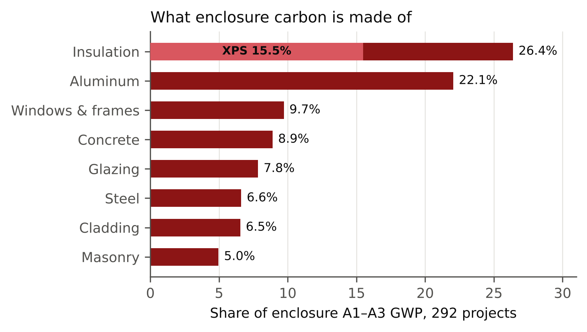
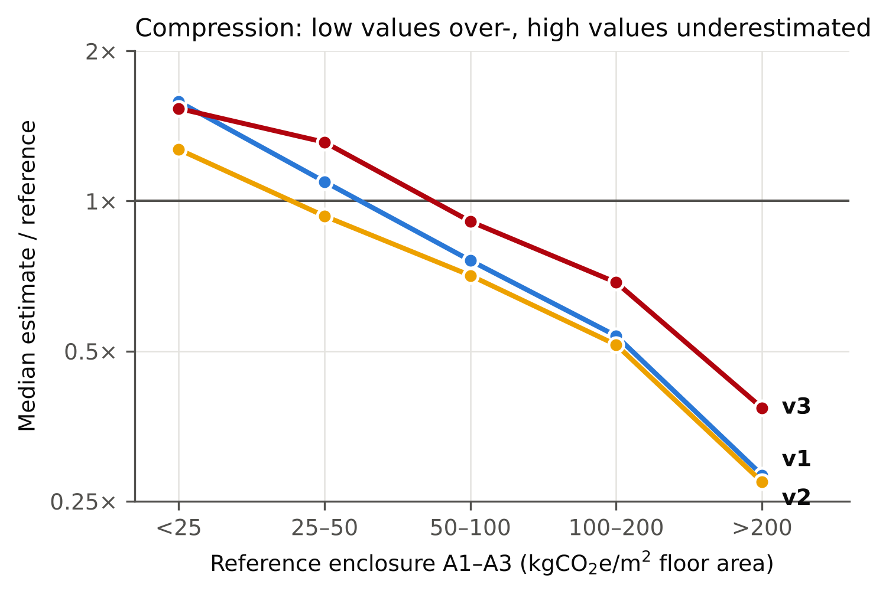
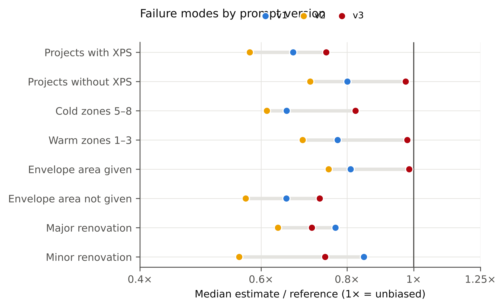
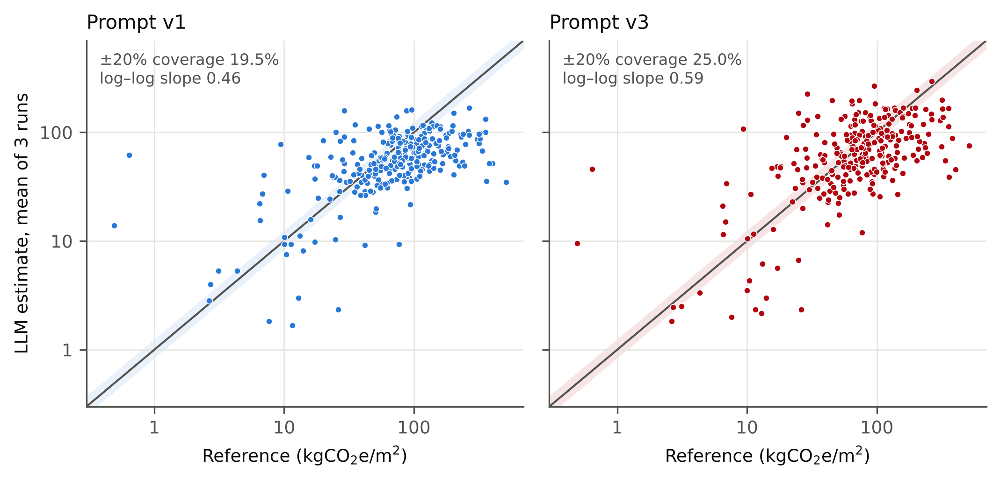
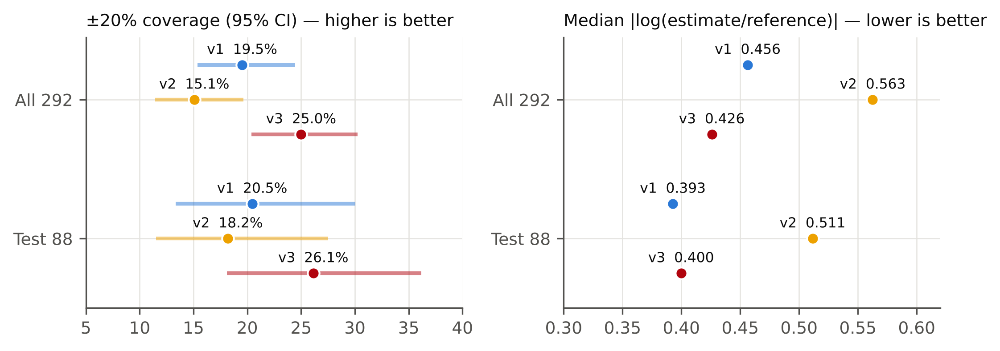
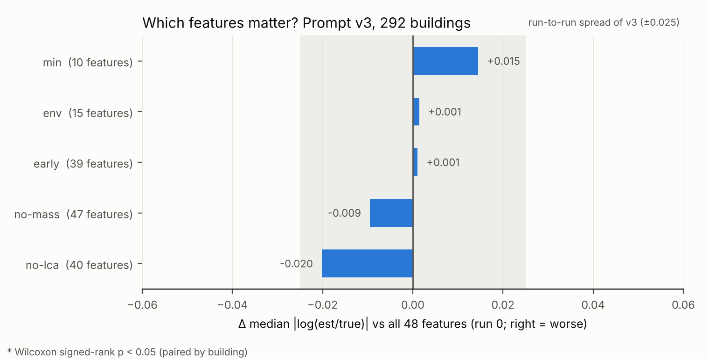
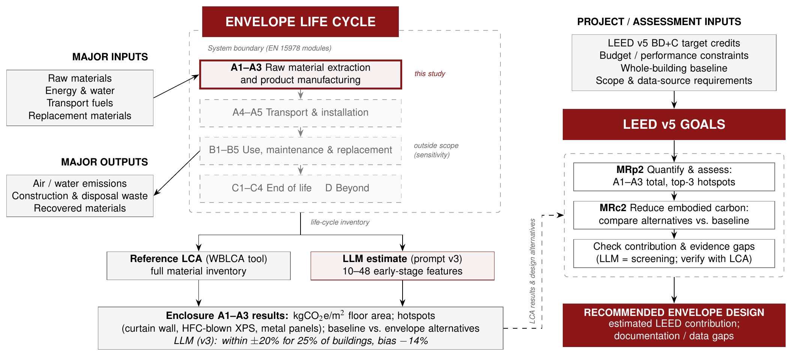

# LLM 能估算建筑外围护结构的隐含碳吗？误差分析、Prompt 设计与 LEED v5 启示

CEE226 第 8 组：George Zheng（jhzheng@stanford.edu）、Zixuan Zhao（zalex467@stanford.edu）、Heshan Chen（heshan@stanford.edu）、Fei Cheng（feicheng@stanford.edu）、Jamie Liu（jamiexyl@stanford.edu）。
本文属于项目 *Climate- and Use-Specific Embodied Impacts of Exterior Wall Design: A Comparative LCA and Implications for LEED v5 Embodied Carbon Credits*。

> English version: [`report.md`](report.md)。两个版本内容一致；最终 prompt 以英文原文为准（附录 A）。
>
> 状态：已完成。v1–v3 三版 prompt 在 292 栋建筑上各跑 3 轮，并做了围护文献 domain 条件（第 8.2 节）、88 栋测试集的 held-out 评估（第 9 节）和 feature 研究（第 10 节）。最终 prompt 为 v3（附录 A 的 E 节）。
> 报告中的所有数字都可以用附录 B 的命令重新生成。

## 1. 摘要

本研究使用的 LLM 是 Claude Opus 5.5，以 Claude Code subagent 的方式运行，reasoning effort 设为 medium。研究对象是 CLF 统一化 WBLCA 数据集中的 292 栋建筑，模型拿到每栋楼的 48 个早期设计 feature，估算**建筑外围护结构（enclosure）在摇篮到大门阶段（A1–A3）的隐含碳**，单位为每 m² 楼面面积的 kgCO2e。

使用最简单的 prompt（v1，只靠模型自身知识）时，只有 **19.5%** 的估算落在参考 LCA 值的 ±20% 以内。RMSE 为 79.7 kgCO2e/m²，绝对百分比误差的中位数为 37.9%。

这些误差不是随机的。模型的问题有四个：

1. 把每栋楼都往一个"典型值"（约 50–60 kgCO2e/m²）上压；
2. 漏掉了数据里最大的单一材料来源：用 HFC 发泡剂生产的 XPS 保温板；
3. 没有给出围护面积时，模型自己估的面积偏小；
4. 对改造项目的工程范围判断有误。

模型最大的几个高估，多数是参考 LCA 本身不完整造成的。

我们根据这些分析写了 prompt v2，做了以下改动：

- 按数据集的分类方式定义 enclosure 的范围；
- 要求逐个构件计算；
- 点名高碳材料；
- 不许往典型值靠；
- 加入改造项目的规则；
- 要求额外给出一个最佳估计值。

prompt v2 的设计见第 6 节，全文见附录 A。

v2 让模型**更稳定**（CV 从 19.0% 降到 13.8%），压缩也**减轻**了（斜率从 0.46 升到 0.55），但**准确率反而下降**：命中率降到 15.1%（McNemar p = 0.085），APE 中位数升到 44.3%，偏差从 0.75 降到 0.67。原因有三点（第 7 节）：

- 模型提到了 XPS，却仍然默认屋面用 polyiso；
- 自下而上累加的构件强度偏低；
- 改造项目的规则把估算往下压了。

简单说，prompt 里的定性知识模型会照着复述，但不会用到数字里；要改变数字，必须在模型选数值的那一步直接给出具体数值。

prompt v3 正是这样做的（第 8 节）：

- 在选强度的那一步，给一张有外部来源的构件强度参考表；
- 写明 HFC-XPS 的工具建模习惯；
- 加入每 m² 围护面积的自检；
- 改写改造项目的规则，不再一味往下减。

**v3 是最终 prompt。** 在全部 292 栋上：

- 命中率 **25.0%**（v1 为 19.5%），RMSE 76.0，偏差 0.86，CV 12.5%。
- 相对 v1 的提升方向一致，但只是接近显著（McNemar p = 0.085，Wilcoxon p = 0.053）；相对 v2 的提升明显显著（p = 0.002）。
- enclosure 里 XPS 以外的部分已经没有偏差（0.99），给了围护面积的建筑也没有偏差（0.99）。
- 仍然存在的问题：高值端还在压缩（真实值 200 以上的楼比值只有 0.38），轻型围护被高估得更多，改造项目估得也不好。

**Held-out 测试集**（88 栋，分层切分；第 9 节）：

- v3 的命中率 26.1%（v1 为 20.5%），RMSE 69.2（v1 为 74.1），偏差 0.86（v1 为 0.75），CV 11.2%（v1 为 19.2%）。
- log 误差中位数和 v1 持平，这个样本量下 v1 与 v3 的差异不显著（McNemar p = 0.41）。
- 促成 v2、v3 的所有发现，只用 204 栋 dev 集也都能复现。

**Feature 研究**（第 10 节）。用 v3 时，只给 10 个早期设计 feature，准确率就和给全部 48 个一样；去掉 `mass_total` 或 LCA 事后字段也不会变差。不同 feature 集之间的差异，都没有超出同一 prompt 重复运行时的波动。限制准确率的是构造类型信息，而没有任何 feature 提供这一点。

**对 LEED v5 的意义**（第 11 节）。v3 的估算可以在方案阶段用于 MRp2 的热点筛查和围护方案比较，但精度不足以证明单栋建筑在 MRc2 中的减碳。enclosure 只占整楼 A–C 隐含碳的约 19%，所以围护减碳 30% 只相当于整楼约 6%。

**把围护文献放进 context**（第 8.2 节）。按 TA 的建议，我们把原来的整楼论文换成 4 份围护相关文献，prompt 仍用 v1，单跑一轮。结果反而**更差**：log 误差中位数增加 0.090（Wilcoxon p < 0.001），偏差从 0.72 降到 0.61。原因是这些文献描述的是现在的低碳产品，而参考 LCA 用的是评估当年的工具数据。v3 在所有指标上都优于这个条件。

**气候与用途**（第 2 节，proposal 的 RQ1）。用途对 enclosure 碳排影响显著（p < 10⁻⁶）：多户住宅中位数 53.6，办公 87.2，交通枢纽 157.2 kgCO2e/m²。气候不显著（p = 0.26）：暖区 80.6，4 区 85.9，冷区 95.1。

**热点一致性**（第 11 节，MRp2）。v3 的回答在 94.6% 的情况下提到了参考 LCA 排第一的热点。随机提到同样多类别的期望只有 60.5%。但回答平均提到 6.7 个类别，不是排好序的前 3 名。

**与 proposal 的范围差异。** 11/3 check-in 后，我们改用课程的数据集方案：
- ground truth 改为 292 个真实项目的 enclosure A1–A3 GWP，不再自己建模 3 种墙体构造；单位为每 m² 楼面面积，只评估 GWP。
- RQ1（气候与用途）改为直接从数据分析。
- 知识条件：做了 innate、围护文献 domain 条件，以及两轮 prompt 修订；ontology 条件没有跑。为控制成本，每个条件跑 3 轮，文献条件和 feature 研究各 1 轮，而不是 proposal 写的 10 轮。
- LEED：热点一致性用基于提及的代理指标；MRc2 得分档一致性、LEED 版 ontology，以及成本、规范、性能等 key drivers 只做定性讨论或没有覆盖。

## 2. 数据与 ground truth

**来源。** Benke et al. (2025)，*A Harmonized Dataset of High-Resolution Embodied Life Cycle Assessment Results for Buildings in North America*，Scientific Data（[doi:10.1038/s41597-025-05216-0](https://doi.org/10.1038/s41597-025-05216-0)；数据在 [figshare](https://figshare.com/articles/dataset/28462145)，CC BY 4.0）。`full_lca_results.xlsx` 共 927,950 行，每行对应一个项目在某个构件、某个生命周期阶段的一种材料，涵盖 292 个项目。

**范围。** 只保留 OmniClass 构件 `Shell - Enclosure` 和阶段 `A1-A3`（`GWP-calculation/sum_gwp.py`），剩下 55,807 行。

**归一化。** GWP 总量除以楼面面积：新建项目用 `bldg_cfa`，49 个改造项目用 `bldg_renovated_gfa + bldg_added_gfa`。这和数据集自带的 `eci_a_to_c_cfa` 在 292 个项目上完全一致。这与 proposal 的功能单位（1 m² 外墙）不同：数据集里大多数项目没有外墙面积，而且它的 enclosure 还包括窗、门和屋面。

**分布。** ground truth（`results/ground_truth.csv`）中位数 78.0 kgCO2e/m²，均值 95.6，范围 0.49–513.9，第 5–95 百分位为 10.5–255.7。Enclosure 约占全楼 A–C 总量的 19%（中位数）。

**Enclosure 的碳来自哪些材料**（占全部 enclosure A1–A3 GWP 的比例；`GWP-calculation/enclosure_breakdown.py`）：

| 材料类别 | 占比 | 其中最大的一项 |
|---|---|---|
| 保温 | 26.4% | XPS 占 enclosure 总量的 15.5%（占保温的 59%） |
| 铝 | 22.0% | 铝型材 17.4% |
| 门窗与框 | 9.7% | 铝店面 / 幕墙 7.3% |
| 混凝土 | 8.9% | 预制 3.4% |
| 玻璃 | 7.8% | 中空玻璃 IGU 4.0% |
| 钢 | 6.6% | 冷弯轻钢龙骨 2.9% |
| 外饰面 | 6.5% | 铝复合板 ACM 2.3% |
| 砌体 | 5.0% | 黏土砖 1.9% |

这个数据集里 XPS 的排放因子是 **43.6 kgCO2e/kg**，而高密度矿棉是 1.2，玻璃棉 2.4，polyiso 3.1。这与用 HFC 发泡剂生产的 XPS 相符，当时的 LCA 工具（Tally、One Click LCA）就是这样建模的。292 个项目中有 149 个含有 XPS。

**数据质量标记。** 有 10 个新建项目（27、35、66、74、80、91、141、217、234、264）的 enclosure 清单里**完全没有窗、玻璃、幕墙或店面的 GWP**，但其中一些项目报告的 WWR 是 0.5–0.7。例如项目 74 的 WWR 为 0.65，真实值却只有 0.64 kgCO2e/m²。这更像是原始 LCA 模型不完整，而不是真的有不带玻璃的建筑。为了可比，这些项目保留在所有主要指标里，另外单独报告剔除它们之后的结果（"剔除不完整"）。

**气候与用途（proposal 的 RQ1）。** 只看新建、参考 LCA 完整的 233 个项目（其中 231 个有气候区），单位为 kgCO2e/m² 楼面面积（`analysis/climate_use.py`）：

| 用途 | 项目数 | 中位数 |
|---|---|---|
| 多户住宅 | 44 | 53.6 |
| 仓储 | 20 | 64.5 |
| 医疗 | 12 | 73.0 |
| 办公 | 41 | 87.2 |
| 教育 | 45 | 89.3 |
| 实验室 | 18 | 93.3 |
| 公共集会 | 27 | 95.8 |
| 公共安全 | 10 | 132.6 |
| 交通枢纽 | 9 | 157.2 |

- 用途的差异显著（Kruskal–Wallis p = 2.7×10⁻⁷）。
- 气候不显著（p = 0.26）：暖区（1–3）80.6，4 区 85.9，冷区（5–8）95.1。
- 按每 m² 楼面面积算，用途（通过玻璃比例和围护/楼面面积比）比气候（通过保温）更能决定 enclosure 碳排。

## 3. LLM 实验设置

- **模型。** Claude Opus 5.5，以 Claude Code subagent 方式运行，reasoning effort 为 medium。课程参考代码用的是 Gemini API，本研究没有使用。另外用 Sonnet 5.5 做过一次试跑（49 栋、1 轮），只用来测试流程。
- **输入。** `references/buildings_metadata_LLM.xlsx` 的全部 48 个 feature（算上 `project_index` 共 49 列），再加 feature 说明表。不提供论文、benchmark 表或 ontology，即"只靠模型自身知识"的条件。
- **流程。** 每版 prompt 跑 292 栋 × 3 轮 = 876 个估算。每个 subagent 负责一个任务文件，内容是共享上下文加 48–49 栋楼。每一轮用固定种子（1000 + 轮次编号）打乱楼的顺序，再分成 6 组。各版 prompt 使用完全相同的分组，因此可以逐栋楼配对比较。
- **隔离。** subagent 只能读自己的任务文件、写自己的答案文件，不能联网、不能运行代码、不能打开其他文件，所以看不到 ground truth。和单独调用 API 不同，同一个任务文件里的楼共享一个上下文。我们在指令里要求模型独立判断每一栋楼，并且每一轮重新打乱顺序，让每栋楼的"邻居"轮轮不同。
- **解析。** 沿用课程的解析器（`RANGE_kgCO2e_per_m2: low - high`，取最后一个匹配），只改了一处：允许下限为 0。v1 中有 11 个改造或租户装修项目的回答下限为 0（例如"0 – 5"），这些项目的真实值是 2.6–26 kgCO2e/m²，其中 10 个低于 14。如果用课程原来的解析器，丢掉的恰恰是这些低碳项目。prompt v2 另外增加了一行 `BEST_kgCO2e_per_m2`。
- **指标。** 每栋楼的估算值取各轮区间中点的平均。准确率指标包括：±20% 命中率（真实值落在估算值 ±20% 以内，附 Wilson 95% 置信区间）、RMSE、MAE、MAPE、APE 中位数，以及估算/真实值的几何平均（衡量偏差）。一致性指标是各轮之间的变异系数 CV。结果还按气候区和建筑用途分组（对应 RQ1）。所用脚本：`LLM-data-cleaning.py`、`make_fig1_bands.py`、`summarize_run.py`、`analysis/error_analysis.py`。

## 4. Baseline 结果（prompt v1）

876 个答案全部解析成功（`results/20261104_baseline-innate/`）。

| 子集 | n | ±20% 命中率 | RMSE | APE 中位数 | 估算/真实（几何平均） | 各轮 CV |
|---|---|---|---|---|---|---|
| 全部项目 | 292 | 19.5%（CI 15.4–24.5%） | 79.7 | 37.9% | 0.75 | 19.0% |
| 新建项目 | 243 | 18.9% | 77.4 | 37.5% | 0.76 | 17.3% |
| 剔除 10 个不完整 ground truth | 282 | 20.2% | 80.5 | 37.3% | 0.72 | 19.1% |

63% 的楼真实值高于 ±20% 区间（被低估），17.5% 低于区间（被高估）。

图：`results/20261104_baseline-innate/figures/fig1_bands_sorted.png`（区间图）、`fig2_estimate_vs_truth.png`（散点图）、`fig3_ratio_by_group.png`（按气候区和用途分组）。

这些结果不能和课程上整栋楼 A–C 的结果（Gemini，命中率 34–46%）直接比较，因为研究范围、模型和 ground truth 都不一样。

## 5. 误差分析：模型为什么低估、为什么高估

数据来源：`analysis/error_analysis_20261104_baseline-innate.md`，以及逐材料的 ground truth 和 876 段推理文字。

### 5.1 主要模式是"压缩"，而不是整体一致地低估

| 真实值（kgCO2e/m²） | n | 估算/真实（中位数） |
|---|---|---|
| < 25 | 36 | 1.58（高估） |
| 25–50 | 43 | 1.09 |
| 50–100 | 114 | 0.76 |
| 100–200 | 72 | 0.54 |
| > 200 | 27 | 0.28 |

- 估算对真实值在 log-log 坐标下的回归斜率只有 **0.46**：真实值翻一倍，估算只增加约 37%。
- 估算值在各楼之间的标准差，只有真实值标准差的 0.39。
- 估算范围是 1.7–168 kgCO2e/m²，真实值范围是 0.5–514。
- 区间中点集中在 42–62 kgCO2e/m²。
- 误差最大的 20 栋楼贡献了 68% 的平方误差，而且这 20 栋全部是低估。

模型对几何信息的依赖超出了数据本身的支持。围护面积与楼面面积之比，和 log 估算的相关是 0.62，和 log 真实值只有 0.39；单位面积质量的对应数字是 0.68 对 0.53。模型抓不住的是"每 m² 围护面积的碳强度"：真实值里这个强度从 19 到 278 kgCO2e/m² 围护（第 5–95 百分位），估算值里只有 20 到 144。仅这一项就和 log 误差有 −0.79 的相关。这个强度由材料和构造选择决定，而 **48 个 feature 里没有一个描述外墙构造**。

### 5.2 为什么低估

1. **HFC 发泡的 XPS 是最大的单一原因，而模型完全没考虑。**
   - XPS 占全部 enclosure 碳排的 15.5%，出现在 149 个项目里。但模型只在 0.6% 的回答里提到 XPS（在含 XPS 的项目中是 0.7%），提到 HFC 发泡剂的一次都没有。
   - 含 XPS 的项目估算/真实中位数为 0.67，不含的为 0.80；XPS 占真实值 30% 以上的项目只有 0.59。
   - 把 XPS 从真实值里扣掉，估算/(真实 − XPS) 的中位数从 0.72 升到 0.84。**系统性低估大约有一半来自 XPS。**
   - 例子：project-198（酒店，4C 区）真实值 361.8，其中 XPS 占 325.9。模型的计算假设屋面约 30 kgCO2e/m²，估算只有 22–36。

2. **气候区差异也来自 XPS。**
   - 寒冷区（5–8 区）估算/真实中位数 0.65，温暖区（1–3 区）为 0.77。
   - 5A、5B 区有 65–68% 的项目含 XPS（比值 0.64–0.65），3B、3C 区只有 26–33%（比值 0.83–0.86）。寒冷地区保温更厚，HFC-XPS 层的分量就更重。
   - 所以气候区的差异本质上是保温材料的效应，不能说明模型忽视了气候。

3. **没有给围护面积时，模型自己估的面积偏小。**
   - 160 个项目给了 `bldg_therm_env_area`。给了时比值中位数为 0.81，没给时为 0.65。
   - 高层建筑差距最大：21 层以上没给面积时为 0.24，给了时为 0.67。
   - 例子：project-198 是 2–5 层的建筑，模型假设围护/楼面面积比约为 0.6，而数据中 2–5 层建筑的中位数是 1.07，这可能是因为数据集的热工围护面积包含了首层底板。

4. **铝幕墙的分布尾巴很长。**
   - 铝占总量的 22%，单个项目仅幕墙一项就能达到每 m² 楼面 300 kgCO2e。
   - 例子：project-137（办公，小型改造）真实值 513.9，其中 302 来自新换的幕墙。模型推断"小改造会保留原有幕墙"，只估了 35。

5. **改造项目的范围估得太窄。**
   - 60% 的大型改造被低估，租户装修的比值低到 0.24。模型倾向于假设原有围护被保留。
   - 能反映新做了多少材料的 feature 是"单位面积 `mass_total`"（和真实值相关 0.53），但只有 8.6% 的回答用到了它。

6. **v1 写的范围比数据集里的 enclosure 窄。**
   - 统一化数据里，有 11% 的 enclosure GWP 在原始软件中被标为 "Superstructure"（主要是屋面 XPS/PIR 和屋面防水），9.6% 标为 "Undefined"。
   - 外墙龙骨、衬板、外墙内侧石膏板、楼板边缘和地下保温也都算在 enclosure 里。
   - v1 的范围描述（"外墙与饰面、窗、幕墙、门、屋面及其保温"）把这些都留给模型自己判断。

### 5.3 为什么高估

1. **参考 LCA 不完整。** 那 10 个被标记、完全没有门窗玻璃 GWP 的新建项目，估算/真实中位数为 3.09。模型对它们的估算是合理建筑应有的数值，不合理的是参考值。例如 project-74 的 WWR 为 0.65，模型估 62，真实值只有 0.64。
2. **新做的围护工程很少。** 真实值低于 25 kgCO2e/m² 的项目（比值中位数 1.58）大多是租户装修和小型改造，而 feature 里没有信息说明到底换了多少围护。

### 5.4 已排除的因素

R 值、WWR、建筑规模、竣工年份和 `lca_ec_reductions` 与误差的相关都很弱（|r| ≤ 0.26）。各轮之间的一致性尚可：CV 中位数 17%，均值 19%。

## 6. Prompt v2

v2 的任务文本替换了 v1。system prompt 和共享上下文（feature 说明表）不变，模型、effort、feature、种子和分组也都不变。全文见附录 A 的 D 节。

| Baseline 发现（第 5 节） | Prompt v2 的改动 |
|---|---|
| 5.2.6：范围比数据集的 enclosure 窄 | 按数据集写明范围：完整外墙构造（饰面、龙骨、衬板、保温、隔汽层、内侧石膏板）、门窗玻璃、结构板以上的屋面构造、楼板边缘和地下保温；并明确列出排除项 |
| 5.1：靠几何、强度靠猜；5.2.3：围护面积估小 | 规定计算方法：(1) 用 `bldg_therm_env_area` 取面积，或自行估算并写出围护/楼面面积比；(2) 选构造，写出保温类型和厚度；(3) 给每个构件的单位面积强度；(4) 加总后除以楼面面积 |
| 5.2.1–5.2.2：漏掉 XPS、气候差异；5.2.4：幕墙长尾 | 点名高碳材料：HFC 发泡 XPS（按单位热阻计，GWP 约为矿棉、玻璃棉、polyiso 的 10 倍以上）、铝幕墙（约 100–200 kgCO2e/m² 立面）、中空玻璃、预制混凝土、砌体 |
| 5.1：往典型值压缩 | "不要把估算往典型建筑靠"，并点出两端（> 200 和 < 10 kgCO2e/m²） |
| 5.2.5、5.3.2：改造项目 | 只计新材料；用 `bldg_proj_type`、`lca_phys_scope` 和单位面积 `mass_total` 判断工程量 |
| 用宽区间的中点当估算值（区间相对宽度中位数 0.75） | 在 `RANGE` 行之前增加 `BEST_kgCO2e_per_m2` 行（`RANGE` 仍放在最后，课程解析器照常可用） |

**材料说法的出处。** 关于 XPS 的说法是定性的，有外部资料支持：
- 加拿大 Alberta 的 *PERSIST* 保温指南指出，在常见板状保温材料中 XPS 的隐含 GWP 最高，原因是 HFC 发泡剂（[alberta.ca](https://www.alberta.ca/system/files/custom_downloaded_images/tr-dtseries06insul2016.pdf)）。
- 佛蒙特州 R408 隐含碳草案表中，XPS（HFC）为 55.5，矿棉毡为 1.7，polyiso 板为 4.1（[publicservice.vermont.gov](https://publicservice.vermont.gov/sites/dps/files/documents/SECTION%20R408%20Insulation%20Embodied%20Carbon%20Calculation_DRAFT.pdf)）。

幕墙的数值区间依据铝框幕墙 EPD，其 A1–A3 为 117–134 kgCO2e/m²（[One Click LCA EPD 库](https://materials.oneclicklca.com/en/material/aluminium-framed-curtain-wall-system-double-glazed/661cc76cdc501e436af96490)）。Arup 的立面研究给出的是 160–520 kgCO2e/m²，但系统边界更宽，包括 A1–A5、B4 和 C（[Arup](https://arup.com/globalassets/downloads/insights/the-carbon-foot-print-of-facades-the-significance-of-glass.pdf)）。

**关于拟合本数据集的问题。** 促成 v2 的误差分析用的就是评估 v2 的这 292 栋楼。本项目的目标是一个能用到其他项目上的 prompt，而不是针对这 292 栋做校准。因此 v2 只写了在本数据集以外也成立的内容：范围定义、计算步骤和有文献支持的材料事实，不包含中位数、拟合系数等数据集统计量。干净的检验需要换一个数据集做 held-out 评估（第 9 节）。

## 7. 结果：prompt v2 对比 v1

v2 的 876 个答案全部解析成功（`results/20261104_prompt-v2/`），使用和 v1 相同的楼、种子和分组。

| 子集 | Prompt | ±20% 命中率 | RMSE | APE 中位数 | MAPE | 估算/真实（几何平均） | 各轮 CV |
|---|---|---|---|---|---|---|---|
| 全部项目（292） | v1 | **19.5%** | **79.7** | **37.9%** | 96.0% | **0.75** | 19.0% |
| | v2 中点 | 15.1% | 81.0 | 44.3% | **83.0%** | 0.67 | **13.8%** |
| | v2 BEST | 14.4% | 83.2 | 49.4% | 81.4% | 0.59 | 13.8% |
| 新建项目（243） | v1 | 18.9% | 77.4 | 37.5% | 93.4% | 0.76 | 17.3% |
| | v2 中点 | 16.5% | 79.8 | 44.2% | 81.7% | 0.70 | 11.8% |
| 剔除 10 个不完整（282） | v1 | 20.2% | 80.5 | 37.3% | 57.8% | 0.72 | 19.1% |
| | v2 中点 | 15.6% | 81.9 | 43.9% | 57.7% | 0.64 | 13.5% |

**配对检验（同样的 292 栋）。**
- v2 的误差更大（对 |log(估算/真实)| 做 Wilcoxon 符号秩检验，p < 0.0001），只在 34% 的楼上比 v1 更接近真实值。
- 命中率的下降不显著（McNemar p = 0.085）：31 栋只有 v1 命中，18 栋只有 v2 命中。

**Prompt v2 没有提高准确率。** 它提高了一致性、减轻了压缩，但让低估更严重。各项诊断的并列对比见 `analysis/error_analysis_20261104_baseline-innate_vs_20261104_prompt-v2.md`。

| 误差模式（第 5 节） | v1 | v2 | v2 的效果 |
|---|---|---|---|
| 压缩：log-log 斜率（1 = 无压缩） | 0.46 | 0.55 | 变好 |
| 压缩：估算标准差 / 真实值标准差 | 0.39 | 0.47 | 变好 |
| 低值端高估（真实值 < 25）：估算/真实 | 1.58 | 1.27 | 变好 |
| 一致性：各轮 CV 均值 | 19.0% | 13.8% | 变好 |
| 含 XPS 的项目中提到 XPS 的比例 | 0.7% | 39.6% | 模型开始提到它 |
| 含 XPS 的项目：估算/真实 | 0.67 | 0.58 | 变差 |
| 没给围护面积：估算/真实 | 0.65 | 0.57 | 变差 |
| 寒冷区 5–8 / 温暖区 1–3：估算/真实 | 0.65 / 0.77 | 0.61 / 0.69 | 变差（差距相近） |
| 小型改造 / 大型改造：估算/真实 | 0.85 / 0.77 | 0.56 / 0.63 | 变差 |
| 被标记的不完整 ground truth：估算/真实 | 3.09 | 3.07 | 不变（不是 LLM 的错） |

### 7.1 v2 为什么低估得更多

1. **知道一个事实，不等于会用它。**
   - v2 的回答提到 XPS 的频率是原来的 50 倍，但其中 89% 仍然默认屋面保温用 **polyiso**。
   - XPS 大多被放在地下或楼板边缘：这种语境下出现 274 次，在屋面语境下只有 114 次。
   - 而在参考 LCA 里，大部分 XPS 位于屋面或楼板层（XPS GWP 中有 54.5% 在 Tally 中被标为 "Superstructure"）。模型的假设符合常见施工做法，却不符合这些 LCA 模型的搭建方式。
   - 结果，v2 计算里屋面强度的中位数是 **35 kgCO2e/m²**（四分位距 30–40），含 XPS 的项目不但没改善，反而更差了。
2. **自下而上的构件强度偏低。**
   - v2 计算中各构件强度的中位数：不透明墙 80 kgCO2e/m²（四分位距 65–110），屋面 35，玻璃和幕墙 145（四分位距 126–320）。
   - 换算成每 m² 围护面积（有围护面积数据的 160 个项目），v2 的中位数为 66.8，v1 为 72.4，**真实值为 86.7**。
   - 根据早期信息逐项计算，会漏掉参考 LCA 里包含的很多零碎项目。prompt 里给的幕墙区间（100–200 kgCO2e/m²）还被模型当成了默认值（中位数 145）。
3. **改造项目的规则起了反作用。**"只计新的围护材料"让小型改造从 0.85 降到 0.56，大型改造从 0.77 降到 0.63。对一个本来就低估的模型，一条"往下减"的规则只会让情况更糟。
4. **BEST 低于区间中点**（中位数为中点的 0.93 倍）。模型的不确定性是右偏的，所以它自报的最佳估计在这里反而更不准。

### 7.2 对 prompt 设计的启示

这几条启示不只适用于本数据集：

- **结构化的分步方法**能让模型更稳定（CV 降低 27%），也更少往典型值靠。但它同时把模型对各构件的先验暴露了出来：如果这些先验有偏差，分步结构会把偏差直接带进总数。
- **定性知识**（"XPS 大约高 10 倍"）会被模型在推理里复述，但不会改变数字。要改变估算，prompt 必须**在模型选数值的那一步给出具体数值**，并说明适用条件（例如 LCA 工具很可能是按哪种保温建模的）。
- **往下减的指令**（排除项、"只计新材料"）要和"应该包含什么"配套给出，否则会放大已有的低估。
- 报告时用**区间中点**，不要用模型自报的最佳值。

## 8. Prompt v3

v3 保留了 v2 中有效的部分：范围定义、分步方法和"不要往典型值靠"。第 7 节证明无效的部分则做了修改。全文见附录 A 的 E 节。

| v2 的结果（第 7.1 节） | Prompt v3 的改动 |
|---|---|
| 提到了 XPS 却没用上；默认 polyiso 屋面 | 第 2 步写明工具建模习惯：这一时期的整楼 LCA 模型（Tally、One Click LCA）常把屋面和地下保温按 HFC-XPS 建模。保温类型不明确时，区间必须包含这种情况，寒冷地区尤其要考虑 |
| 自下而上的构件强度偏低 | 第 3 步给出每 m² 构件的 A1–A3 强度参考表：8 类外墙、3 类门窗幕墙、按保温类型分的屋面构造（HFC-XPS：只计生产阶段为 85–110，把发泡剂排放计入产品时最高 335–410）、每 m²·RSI 的保温强度、每 kg 铝的排放。同时告诉模型完整构造包括龙骨、连接件、隔汽层、密封胶和收边，除非构造明显很简单，不要低于区间下限 |
| 没有对总数做自检 | 第 4 步：把总数换算成每 m² 围护面积。对于常规外墙、30–40% 玻璃比例的新建项目，如果低于约 50 kgCO2e/m² 围护，说明漏了某个构件或高碳选项 |
| 区间没包含高碳的可能 | 第 5 步：区间必须包含合理的高碳选项（以中点作为估算值） |
| 改造项目的规则往下减 | 第 6 步改写为：改造项目常常包含大量新的围护工程（换外饰面、换幕墙或窗、重做屋面），除非数据显示原有围护被保留，否则不要这样假设 |
| BEST 不如中点准 | 改回只输出一行 `RANGE` |

**来源。** 参考数值由另一个能联网的 research subagent 整理，写在 [`references/envelope_intensities_sources.md`](../references/envelope_intensities_sources.md) 里，附有来源链接、系统边界和单位换算。来源包括：
- CLF 北美材料基准（2023 和 2025）；
- PCI 预制混凝土行业平均 EPD（2025）；
- Kawneer 的幕墙、店面和窗 EPD（2021）；
- RDH Building Science 的外墙构造研究；
- UBC 的门窗研究；
- SPRI、NAIMA、AEC 的行业 EPD（通过 CLF 基准引用）；
- Arup/Saint-Gobain 的立面研究。

研究要求中明确排除了 Benke et al. 数据集及其衍生内容。subagent 还主动排除了 CLF WBLCA Benchmark v2 的结果，因为它们很可能和 ground truth 共用源模型。部分外墙数值是 subagent 自己把各构件加总得到的，在那个文件里标为不确定。第 4 步中"每 m² 围护低于约 50"这个阈值，是我们从这些构件区间推导出来的，不是已发表的基准值。

### 8.1 结果：prompt v3 对比 v2 和 v1

v3 的 876 个答案全部解析成功（`results/20261104_prompt-v3/`）。模型、effort、feature、楼、种子和分组都和 v1、v2 相同。

第 2 轮运行中，容器重启打断了 6 个 subagent，当时这一轮 292 个答案只完成了 130 个。其余 162 栋由 6 个续跑 subagent 完成，prompt 相同，任务文件里只包含缺失的楼（`subagent_runs.py resume`，已记录在 manifest 中）。因此这 162 栋共享上下文时的"邻居"和原计划不同。

| 子集 | Prompt | ±20% 命中率 | RMSE | APE 中位数 | 估算/真实（几何平均） | 各轮 CV |
|---|---|---|---|---|---|---|
| 全部项目（292） | v1 | 19.5%（15.4–24.5） | 79.7 | **37.9%** | 0.75 | 19.0% |
| | v2 | 15.1%（11.4–19.6） | 81.0 | 44.3% | 0.67 | 13.8% |
| | **v3** | **25.0%（20.4–30.3）** | **76.0** | 40.0% | **0.86** | **12.5%** |
| 新建项目（243） | v1 | 18.9% | 77.4 | 37.5% | 0.76 | 17.3% |
| | **v3** | **26.3%** | **74.1** | 38.0% | **0.91** | **10.9%** |
| 剔除 10 个不完整（282） | v1 | 20.2% | 80.5 | 37.3% | 0.72 | 19.1% |
| | **v3** | **25.9%** | **76.5** | 37.4% | **0.83** | **12.6%** |

**配对检验（同样的 292 栋）。**
- **v3 对 v1**：46 栋只有 v3 命中，30 栋只有 v1 命中（McNemar p = 0.085）。|log(估算/真实)| 的中位数从 0.456 降到 0.426（Wilcoxon p = 0.053），v3 在 57% 的楼上更接近真实值。在 3 轮 × 292 栋的规模下，提升方向一致，但只是接近显著。
- **v3 对 v2**：提升显著（McNemar p = 0.002；Wilcoxon p < 0.0001），v3 在 66% 的楼上更接近真实值。
- **APE 中位数**：v3 的 log 误差更低，APE 中位数却比 v1 略差（40.0% 对 37.9%）。原因是 v3 把估算整体往上调了，而 APE 对高估的惩罚比对低估重。
- **高估和低估的比例**：v1 下 58% 的楼低估超过 20%、18% 高估超过 20%；v3 下这两个比例变为 46% 和 29%。偏差变小了，误差的分布也更均衡。

| 误差模式（第 5 节） | v1 | v2 | v3 |
|---|---|---|---|
| 整体偏差：估算/真实（几何平均） | 0.75 | 0.67 | **0.86** |
| 压缩：log-log 斜率（1 = 无压缩） | 0.46 | 0.55 | **0.59** |
| 压缩：估算标准差 / 真实值标准差 | 0.39 | 0.47 | **0.63** |
| 真实值 50–100：估算/真实 | 0.76 | 0.71 | **0.91** |
| 真实值 100–200 / > 200：估算/真实 | 0.54 / 0.28 | 0.51 / 0.27 | **0.69 / 0.38** |
| 真实值 < 25 / 25–50：估算/真实 | 1.58 / 1.09 | **1.27 / 0.93** | 1.53 / 1.31 |
| 含 XPS 的项目中提到 XPS 的比例 | 0.7% | 39.6% | **96.0%** |
| 提到 HFC / 发泡剂的比例 | 0% | 4% | **88%** |
| 含 XPS 的项目：估算/真实 | 0.67 | 0.58 | **0.75** |
| 估算/(真实 − XPS) | 0.84 | 0.77 | **0.99** |
| 寒冷区 5–8 / 温暖区 1–3：估算/真实 | 0.65 / 0.77 | 0.61 / 0.69 | **0.82 / 0.98** |
| 给了 / 没给围护面积：估算/真实 | 0.81 / 0.65 | 0.75 / 0.57 | **0.99 / 0.73** |
| 小型 / 大型改造：估算/真实 | **0.85 / 0.77** | 0.56 / 0.63 | 0.74 / 0.71 |
| 租户装修：估算/真实 | 0.24 | 0.26 | 0.26 |

**有效的部分。**
- **在选数值的那一步给出具体数值。** 在含 XPS 的项目上，96% 的回答提到了 XPS（以及它的发泡剂）。
- **XPS 以外的 enclosure 部分已经没有偏差**：估算/(真实 − XPS) 从 0.84 升到 0.99。
- **给了围护面积时，估算整体没有偏差**（0.99）。修正自下而上总数偏低的，是构件参考值和每 m² 围护的自检这两项。
- **温暖区的气候差距消除了**：温暖区现在是 0.98。寒冷区（0.82）仍然低估，原因是厚的 HFC-XPS 层：XPS 占真实值 30% 以上的项目仍只有 0.61。

**尚未解决的部分。**
1. **压缩减轻了，但没有消除**（斜率 0.59）。真实值 200 以上的楼仍只有 0.38，它们的极端数值（例如幕墙或 XPS 超过 300 kgCO2e/m²）无法从 feature 推出来。
2. **低碳建筑现在被高估得更多。** 真实值 25–50 那一档，比值从 1.09 升到 1.31。"不要低于区间下限"和每 m² 围护的自检，会把轻型围护往上推，这是纠正低估付出的代价。
3. **没给围护面积时仍然低估**（0.73）。
4. **改造项目仍不如 v1。** 比 v2 有所恢复，但没回到 v1 的水平；租户装修仍停在 0.26。

**最终 prompt。** 在命中率、RMSE、偏差、log 误差和一致性上，v3 都是三版中最好的，因此作为本研究的最终 prompt（附录 A 的 E 节）。

### 8.2 对照：把围护文献放进 context（domain knowledge）

课程框架里，domain knowledge 的做法是把参考文献放进 context。按 TA 在 check-in 上的建议，我们把原来的整楼论文换成 4 份围护相关文献：
- RDH Building Science 的墙体构造 LCA（2025）；
- CLF 2023 北美材料基准；
- Arup/Saint-Gobain 的幕墙与玻璃研究；
- UBC 的门窗隐含碳研究（2022）。

每份截取 30k 字符，和课程流程一样。任务文本保持 v1 不变，所以和 baseline 的唯一区别就是这些文献。这个条件只跑了一轮，与 v1、v3 的第 0 轮逐栋配对比较（分块和顺序相同；`analysis/domain_study.py`）。

| 条件 | 命中率 | log 误差中位数 | 偏差 | RMSE |
|---|---|---|---|---|
| v1（innate） | 17.8% | 0.519 | 0.72 | 81.2 |
| v1 + 文献 | 15.8% | 0.609 | 0.61 | 85.3 |
| v3（最终 prompt） | 24.3% | 0.461 | 0.86 | 77.8 |

**结果：文献让估算变差了。**
- log 误差中位数增加 0.090（Wilcoxon p < 0.001），偏差从 0.72 降到 0.61，只有 35% 的楼变得更准。命中率下降 2.1 个百分点，不显著（p = 0.48）。
- v3 在所有指标上都优于文献条件（命中率 +8.6 个百分点，McNemar p = 0.011；log 误差 −0.148，p < 0.001）。

**原因。** 模型确实读了文献：22% 的回答引用了它们，多半是用来支持区间的下限（"per RDH"，"CLF baselines support the lower end"）。但这些文献描述的是**现在的**低碳产品：HFO 发泡的喷涂泡沫、近年的 EPD 基准、现代玻璃。而参考 LCA 用的是评估当年的工具数据。
- 回答里提到 XPS 的比例从 0.7% 降到 0；
- 有 XPS 的项目，比值从 0.64 降到 0.50；
- 没有 XPS 的项目，也从 0.78 降到 0.68。

和 v2 一样，这说明给更多领域文字并不能纠正盲点；如果文字描述的产品年代和参考模型不同，反而会加重盲点。v3 有效的是一张有来源的强度表，加上一句关于建模习惯的明确说明。

## 9. Held-out 评估

**没有合适的外部数据集。** 我们找过结构相同的独立数据集（北美建筑、按构件分的 enclosure A1–A3 结果、加上早期设计 feature），没有找到：
- CLF WBLCA Benchmark v2 的结果很可能和 Benke et al. 数据集共用源模型。
- 开放的 CarbEnMats / Global Buildings Database（[Zenodo](https://zenodo.org/records/8363895)）有 1,200 多个案例，但只有 172 个给出了 envelope 的 A1–A3 数值，而且全在欧洲（比利时 105、荷兰 47、芬兰 19、英国 1）。它的 "envelope" 只包括开口和饰面，外墙和屋面算在结构里。这 172 栋的围护面积、WWR 和 U 值全是空的，只有 12% 有层数。我们检查过数据，决定不做映射。
- Mendeley 的 "virtual building database"（[链接](https://data.mendeley.com/datasets/znbp3szd75/1)）是合成数据。

因此，我们从本数据集中留出一部分作为测试集。

**切分方法。** `analysis/make_split.py`（种子 226）把 30% 的项目分到测试集（88 个），70% 分到 dev 集（204 个），只按输入 feature 分层：新建/改造 × 气候组（寒冷区 5–8、4 区、温暖区 1–3、其他）。两组的真实值中位数相近（78.8 / 74.6 kgCO2e/m²）。测试集中含 XPS 的项目较少（43%，dev 为 54%），10 个被标记的不完整 ground truth 中有 2 个在测试集。

**切分是在 v1–v3 都跑完之后才定的。** 因此，设计 v2 和 v3 时做的误差分析，已经看过包括测试集在内的全部 292 栋的整体规律。为了检验这一点没有左右 prompt 设计，我们只用 dev 集重新做了全部诊断（`analysis/error_analysis_…_dev.md`）。用来修改 prompt 的每一项发现在 dev 集上都能复现：

| 促成 prompt 修改的发现 | 全部 292 栋 | 只用 dev（204 栋） |
|---|---|---|
| v1 压缩：log-log 斜率 | 0.46 | 0.44 |
| v1 真实值 > 200 / < 25 时的估算/真实 | 0.28 / 1.58 | 0.28 / 1.59 |
| XPS 占 enclosure A1–A3 GWP 的比例 | 15.5% | 14.7% |
| v1 含 / 不含 XPS 的估算/真实 | 0.67 对 0.80 | 0.66 对 0.77 |
| v1 估算/(真实 − XPS) | 0.84 | 0.80 |
| v1 寒冷区 / 温暖区 | 0.65 对 0.77 | 0.64 对 0.71 |
| v1 给了 / 没给围护面积 | 0.81 对 0.65 | 0.79 对 0.65 |
| v1 提到 XPS 的回答比例 | 0.6% | 0.5% |
| 被标记的不完整 ground truth：v1 估算/真实 | 3.09 | 3.09 |
| v2 回答中屋面用 polyiso 的比例；屋面强度中位数 | 89%；35 | 89%；35 |
| v2 每 m² 围护的估算 vs 真实值 | 66.8 对 86.7 | 68.1 对 85.5 |
| v2 小型改造的估算/真实（v1 → v2） | 0.85 → 0.56 | 0.79 → 0.40 |

也就是说，只用 dev 集也会得出同样的 prompt 修改。两版 prompt 都不包含任何单栋楼的信息或从本数据集算出的统计量，v3 的参考数值全部来自外部 EPD 和基准。

**测试集结果（88 栋，从未用来挑选 prompt）：** `analysis/compare_…md`

| Prompt | ±20% 命中率（95% CI） | RMSE | APE 中位数 | log 误差绝对值中位数 | 估算/真实（几何平均） | 各轮 CV |
|---|---|---|---|---|---|---|
| v1 | 20.5%（13.3–30.0） | 74.1 | **36.4%** | **0.393** | 0.75 | 19.2% |
| v2 | 18.2%（11.5–27.5） | 75.7 | 43.4% | 0.511 | 0.66 | 15.2% |
| **v3** | **26.1%（18.1–36.2）** | **69.2** | 37.0% | 0.400 | **0.86** | **11.2%** |

| 测试集配对 | 只有前者命中 / 只有后者命中 | McNemar p | log 误差绝对值（Wilcoxon p） | 后者更接近的比例 |
|---|---|---|---|---|
| v1 对 v3 | 9 / 14 | 0.41 | 0.393 → 0.400（p = 0.38） | 55% |
| v2 对 v3 | 11 / 18 | 0.27 | 0.511 → 0.400（p = 0.002） | 62% |
| v1 对 v2 | 9 / 7 | 0.80 | 0.393 → 0.511（p = 0.0002） | 34% |

**怎么解读 held-out 结果。**
- 在测试集上，v3 的命中率提高 5.6 个百分点，RMSE 降低 4.9 kgCO2e/m²，偏差从 0.75 改善到 0.86，一致性从 CV 19.2% 改善到 11.2%。
- 但它的典型误差（log 误差绝对值中位数）和 v1 持平；在 n = 88 时，v1 与 v3 的各项差异都不显著。
- v3 明显优于 v2（Wilcoxon p = 0.002），v2 比 v1 差这一点在测试集上同样复现（p = 0.0002）。
- 测试集中含 XPS 的项目较少，而这正是 v3 进步最大的地方。另外，v1 在测试集上本身就比在 dev 集上表现好（log 误差绝对值中位数 0.393 对 0.476）。

**结论。** 在全集、dev 和测试集上，v3 的命中率、RMSE、偏差和一致性都是最好的。但它相对 baseline 在典型误差上的优势很小，在 held-out 集上没有得到统计上的确认。要定论，需要更大的测试集或外部数据集。

## 10. Feature 研究：模型需要哪些输入？

**问题。** baseline 分析表明，误差来自构造和材料的选择，而这些在输入里都没有描述（第 5.1 节）。那么模型是否需要全部 48 个 feature，还是早期设计阶段的信息就够了？这正是课程团队建议的 feature 研究 iteration：比较全部输入和几组较小、与围护相关的子集。

**设计。** prompt v3 保持不变，楼、种子、分组、模型（Opus 5.5）和 effort（medium）都和之前一样，只改 feature 列表，feature 说明表也随之筛选。每个子集都保留三个楼面面积字段，因为任务的单位需要用它们来定义。为了控制 token 用量，每个条件只**跑一轮（第 0 轮）**，再和 v3 全部 48 个 feature 的第 0 轮逐栋配对比较（`analysis/feature_study.py`，`analysis/feature_study.md`）。

| 条件 | Feature 数 | 内容 |
|---|---|---|
| all（= v3） | 48 | `buildings_metadata_LLM.xlsx` 的全部列 |
| early | 39 | 去掉 LCA 事后字段（`lca_*`）和 `mass_total`，只保留设计阶段已知的信息 |
| env | 15 | 气候区、州、用途、项目类型、楼面面积、层数、高度、围护面积、WWR、墙体和屋面 R 值、结构类型、IBC 建造类型 |
| min | 10 | 气候区、用途、项目类型、楼面面积、层数、WWR、墙体和屋面 R 值（对应 proposal 6.1） |
| no-lca | 40 | 去掉 8 个 `lca_*` 字段 |
| no-mass | 47 | 去掉 `mass_total` |

`mass_total` 是参考 LCA 自身材料清单的质量总和（A–C 阶段），早期设计阶段无从得知，而且部分包含了答案。它和真实值的相关是 0.53，v2 和 v3 也曾建议用它来判断改造项目。

其余 7 组 leave-one-group-out 消融（地点、规范年份、用途类型、规模、几何、热工、结构）已经准备好（`FEATURE_SETS`），但为了控制 token 用量中止了。`no-geometry` 有 50 个答案，未纳入分析。

**结果（第 0 轮，全部 292 栋；与 "all" 配对）。**

| 条件 | Feature 数 | ±20% 命中率 | log 误差绝对值中位数 | 估算/真实（几何平均） | RMSE | 相对 all 的 log 误差变化 | Wilcoxon p | McNemar p |
|---|---|---|---|---|---|---|---|---|
| all | 48 | 24.3% | 0.461 | 0.86 | 77.8 | – | – | – |
| early | 39 | 21.6% | 0.462 | 0.88 | 81.2 | +0.001 | 0.13 | 0.30 |
| env | 15 | 19.9% | 0.463 | 0.93 | 80.6 | +0.001 | 0.33 | 0.085 |
| min | 10 | **25.3%** | 0.476 | 0.81 | **77.3** | +0.015 | 0.81 | 0.83 |
| no-lca | 40 | **25.3%** | **0.441** | 0.90 | 78.6 | −0.020 | 0.57 | 0.77 |
| no-mass | 47 | 22.6% | 0.452 | 0.85 | 79.2 | −0.009 | 0.92 | 0.56 |

测试集（88 栋）上的情况一样：min 的命中率为 30.7%，all 为 28.4%，log 误差的差异都不显著。测试集上有两处命中率下降，early −8.0 个百分点（p = 0.065）和 env −10.2 个百分点（p = 0.049），但考虑到多重比较（5 个条件 × 3 个切分），都不能算显著，而且两者的 log 误差没有差别（p = 0.08 和 0.11）。

**噪音有多大？** 同一个 prompt 再跑一次，结果的变化和换 feature 集差不多大。v3 三轮各自的命中率分别是 24.3% / 24.3% / 22.3%，log 误差绝对值中位数分别是 0.461 / 0.436 / 0.454，波动 0.025；v1 的对应波动是 3.4 个百分点和 0.048。上面所有 feature 集之间的差异，都落在这个轮次间的波动范围以内（`analysis/figures/feature_study.png`）。

**结论。**
1. **10 个早期设计输入和全部 48 个一样好。** 气候区、用途、项目类型、楼面面积、层数、WWR 和 R 值这几项，准确率就和全部 feature 一样，其余 38 个 feature 没有可测的贡献。这与第 5.1 节一致：缺的是构造信息，任何子集都不提供。对于 proposal 的问题，这是最实用的结果：在方案设计阶段用 LLM 估算，只需要设计师手上已有的信息。
2. **模型不依赖可能泄露答案的字段。** 去掉 `mass_total` 或全部 LCA 事后字段，估算都没有变差，no-lca 甚至略好。所以 v1–v3 的结果并不是靠那些编码了参考 LCA 的 feature 撑起来的。
3. **Prompt 内容比 feature 选择重要得多。** 从 v2 到 v3，log 误差绝对值中位数变化 0.137，命中率变化 10 个百分点（第 8.1 节）；而任何 feature 集带来的变化都不超过 0.020 和 4.5 个百分点。

## 11. 对 LEED v5 的意义

LEED v5 把隐含碳纳入了评分体系：

- **先决条件 MRp2（Quantify and Assess Embodied Carbon）**：量化主要建筑构件（包括外围护结构）的隐含碳，并找出最大的几个热点。
- **得分项 MRc2（Reduce Embodied Carbon）**：奖励减碳。可以用整楼 LCA 与基准方案比较（Option 1），也可以用 EPD 证明产品层面的减碳（Option 2）。

图 11.1 是我们讨论后修改的流程图（初稿为组内的 "Building Envelope LCA and LEED Goals"）。主要修改有三处：

- 在生命周期中标出研究边界：本研究只覆盖 A1–A3，A4–A5、B1–B5、C1–C4/D 标为范围外；
- 加入两条估算路线：参考 LCA 和 LLM 估算（prompt v3），二者都产出 enclosure A1–A3 结果；
- 把右侧的 "LEED goals" 具体化为 LEED v5 的 MRp2 → MRc2 → 检查贡献与证据缺口，最后得到推荐的围护方案，以及它的预计 LEED 贡献和仍缺的文档/数据。

**MRp2：适合做热点筛查。** 方案设计阶段还没有材料清单，而这个先决条件的目的就是把注意力引向最大的排放来源。v3 的估算适合这个用途：

- 偏差小，整体为 −14%，没有 XPS 的建筑基本无偏；
- 模型的推理会点出数据中真正主导 enclosure 碳排的构件：铝幕墙和铝框、保温类型（HFC-XPS）、金属板和玻璃。

**热点一致性的检验**（`analysis/hotspot_agreement.py`）。回答是文字，没有结构化的热点列表，所以用一个代理指标：
- 参考热点：每栋楼 enclosure A1–A3 中最大的 3 个材料类别（共 11 个设计层面的类别）；
- 模型热点：回答里提到的类别（关键词匹配）。

不含 10 个不完整的参考：

| 条件 | 提到第 1 热点 | 前 3 召回率 | 随机提到同样多类别 | 每个回答提到的类别数 | 精确率 |
|---|---|---|---|---|---|
| 固定猜"典型楼"（保温、玻璃、铝） | 71.6% | 61.1% | 27.3% | 3.0 | 60.4% |
| v1 | 81.4% | 77.1% | 51.4% | 5.7 | 42.0% |
| v2 | 93.3% | 89.7% | 67.5% | 7.4 | 36.9% |
| v3 | 94.6% | 89.7% | 60.5% | 6.7 | 41.1% |

- 回答是**针对具体楼**的：第 1 热点不属于常见三类的 80 栋楼里，v3 有 82.1% 提到了第 1 热点，而固定猜典型楼是 0%。
- 但回答**不是排好序的前 3**：平均提到 6.7 个类别，精确率（41%）低于固定猜测（60%）。要用于 MRp2，prompt 应该明确要求按大小列出前 3 个热点。

**MRc2：证明减碳所需的精度，LLM 达不到。** 得分取决于相对基准的减碳百分比，而 v3 的误差是：

- 轮次间 CV 12.5%；
- 绝对误差中位数约 35–40%；
- 只有四分之一的建筑落在 ±20% 以内。

这些误差和项目通常申报的减碳幅度一样大，甚至更大。所以对单栋建筑，LLM 的绝对估算不能用来证明达到得分要求。更有希望的用法是**配对比较**：对同一栋楼、用同一个 prompt 比较不同围护方案，共同的偏差可以部分抵消。这一点本研究没有测试，申报时仍需要正式 LCA。

**Option 1：围护的减碳会被稀释。** 在本数据集中，enclosure 的中位数只占整楼 A–C 隐含碳的 19%。围护减碳 30%，在整楼层面只相当于约 6%。单靠围护很难达到整楼减碳目标，围护决策和结构一起考虑时最有价值。在 Option 2 的产品路径中，HFC 发泡 XPS、铝型材、夹芯金属板这类高碳产品，不同 EPD 之间的差距最大（附录 A 的 v3 参考表）。

**让早期估算和 LEED 基准更可预测的三条建议：**

1. 方案阶段就报告构造类型；
2. 写明 LCA 工具默认使用的保温和铝材数据集。仅 HFC-XPS 这一个建模习惯，就影响了我们估算偏差的一半左右；
3. 标记缺少构件组的清单。本数据集中 10 个不完整的参考 LCA，会扭曲任何以它们为基础的基准。

## 12. 局限与下一步

- **缺少构造信息。** 没有任何 feature 描述外墙构造，所以不论 prompt 怎么写，准确率都有上限。最有希望的改进是按 proposal（6.1 节）原本的设想，把构造类型加入输入。
- **subagent 不等于单独的 API 调用。** 同一个任务文件里的回答共享上下文，独立性不如单独的 API 调用。v3 第 2 轮中有 162 栋是在容器重启后由续跑任务回答的（第 8.1 节）。
- **Held-out 切分是事后才定的。** 只用 dev 集的复现（第 9 节）表明，prompt 的设计不依赖测试集的楼。但要完全排除过拟合，只有用一个从未拿来检验过 prompt 的数据集才行。
- **统计功效。** 3 轮运行下，v3 相对 v1 的提升在全部 292 栋上只是接近显著（McNemar p = 0.085），在 88 栋测试集上不显著（p = 0.41）。增加每栋楼的轮数或增加楼的数量，才能定论。
- **Feature 研究只跑了一轮。** 每个 feature 条件只跑了一次，9 组 leave-one-group-out 消融中有 7 组为控制 token 用量而中止。"feature 集没有影响"这个结论，依据的是落在轮次波动范围以内的差异；它是一个零结果，不能证明这些 feature 无关紧要。
- **功能单位。** 结果是每 m² 楼面面积，而不是每 m² 外墙；enclosure 还包括窗、门和屋面。
- **Ground truth 的质量。** 质量参差不齐：有 10 个项目被标记为不完整，各工具使用的数据年代也不同（HFC XPS）。
- **LEED 分析不完整。** 热点一致性用的是基于提及的代理指标，没有计算 MRc2 得分档的一致性。
- **文献条件只跑一轮。** 只用了 4 份截断到 30k 字符的文献，换别的文献结果可能不同。
- **依赖模型。** 结果取决于所用的模型及其版本（Claude Opus 5.5，effort medium）。
- **下一步：**
  - 在外部数据集或新的项目集上评估最终 prompt（例如把 CarbEnMats/GBDB 的 enclosure 字段映射到本研究的 feature 集）；
  - 加入构造类型的输入（外饰面、保温类型、玻璃系统），也就是 feature 研究显示缺失的信息；
  - 完成其余的 leave-one-group-out 消融（`experiment_config.py` 中的 `FEATURE_SETS`，已准备好）；
  - 用 CLF 材料基准和 EPD 测试领域知识上下文；
  - 按 proposal 的协议扩展到每栋楼 10 轮（种子 1003–1009）。

## 附录 A. Prompt

见 [`appendix_prompts.md`](appendix_prompts.md)，包括：system prompt、共享上下文、任务文本 v1、v2、**v3（最终版）**、一个楼栋示例，以及 subagent 指令模板。Prompt 原文为英文，交付时以英文原文为准。

## 附录 B. 复现

复现命令与英文版 [`report.md`](report.md) 附录 B 相同，依次运行：

1. 生成 ground truth：`python GWP-calculation/sum_gwp.py`
2. 生成材料分解和数据质量标记：`python GWP-calculation/enclosure_breakdown.py`
3. 准备任务文件：`python subagent_runs.py prepare --run-name <run> --runs 3 --model-label "claude-opus-5-5 (Claude Code subagent)" --effort medium`（feature 研究加上 `--feature-set <name> --runs 1`）
4. 每个 `results/<run>/subagent/tasks/*.instructions.txt` 启动一个 Claude Code subagent（Opus，medium），被中断时用 `python subagent_runs.py resume --run-name <run>` 续跑
5. 收集答案：`python subagent_runs.py collect --run-name <run>`
6. 数据清洗和图：`python LLM-data-cleaning.py <run>`、`python make_fig1_bands.py <run>`、`python summarize_run.py <run>`
7. 误差分析：`python analysis/error_analysis.py [--split dev|test] <run1> <run2> ...`
8. Held-out 切分和配对比较：`python analysis/make_split.py`、`python analysis/compare_runs.py <run1> <run2> ...`
9. Feature 研究：`python analysis/feature_study.py`
10. 生成 prompt 附录：`python report/make_prompt_appendix.py`
